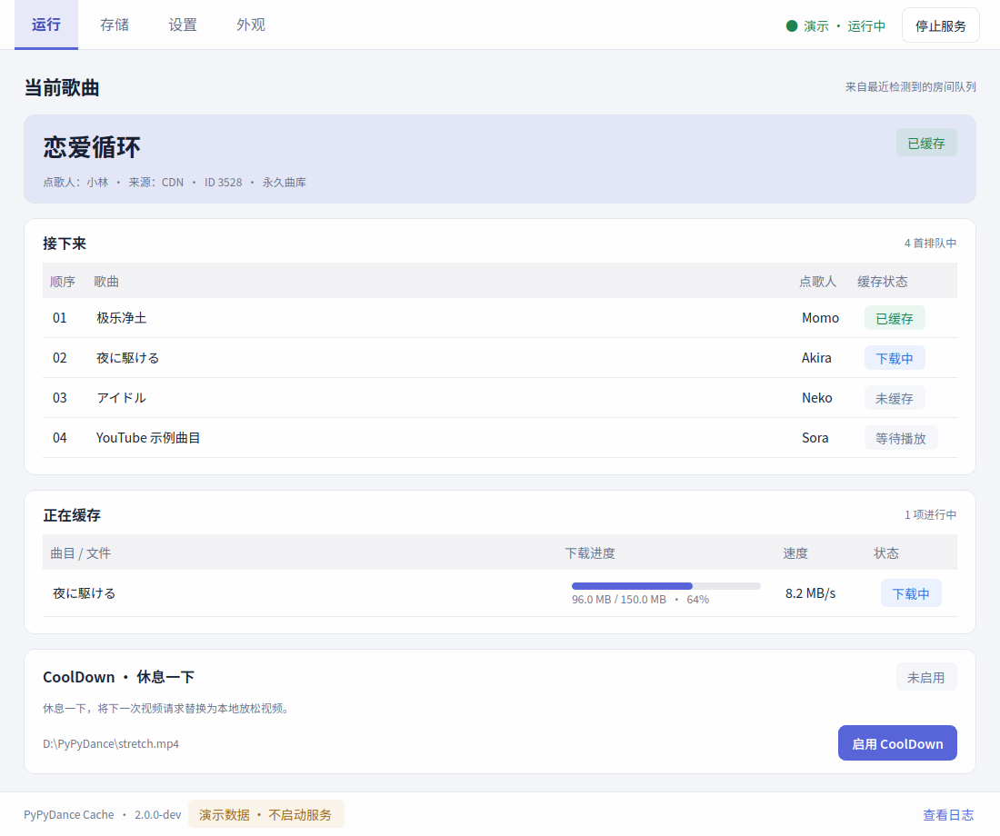
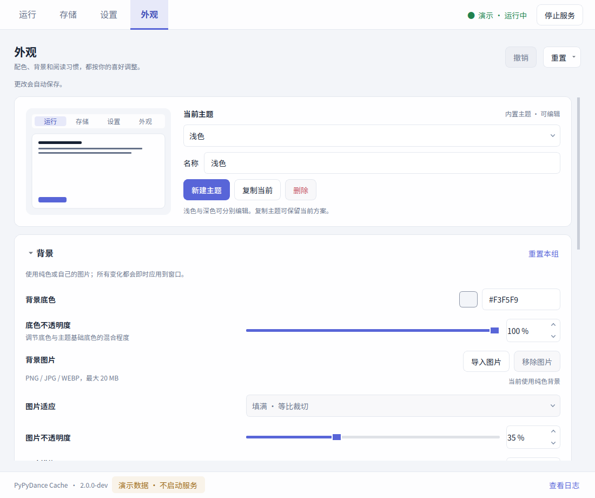

# PyPyDance Cache · UI 重构版

VRChat PyPyDance 跳舞房视频本地缓存工具，面向 Windows。本分支保留原有缓存核心与命令行入口，使用 Qt for Python 重构桌面界面。

**原作者：Bilibili @鲨鲨比亚Sharkspeare**

**上游：[oreochromis/pypydance-video-cache](https://github.com/oreochromis/pypydance-video-cache)**

**当前 fork：[Xiaoyu12-CPU/pypydance-video-cache](https://github.com/Xiaoyu12-CPU/pypydance-video-cache)**

开发基线：上游提交 `5efd712073d696e180ffeedfbfe51afd293f702e`。

原理参考：

- [kiyonya/why-my-dance-video-cannot-play](https://github.com/kiyonya/why-my-dance-video-cannot-play)
- [wzhqwq/VRCDancePreloader](https://github.com/wzhqwq/VRCDancePreloader)

## 界面与功能

四个页面将日常状态、文件保存和个性化选项分开，顶部保留服务状态与启停入口。

| 页面 | 内容 |
| --- | --- |
| **运行** | 最近识别的歌曲队列、缓存任务与结果、Cool Down 放松操作、诊断与日志 |
| **存储** | 临时缓存容量、永久曲库目录与来源开关、目录入口、映射重建和文件大小检查 |
| **设置** | 预加载数量、YouTube 源缓存、网络测速与优选 IP、放松视频配置 |
| **外观** | 浅色/深色与自定义主题、背景图片、配色、界面缩放与密度 |

业务配置编辑后通过**应用更改**提交。修改 YouTube 缓存开关或保存目录前，需要先停止服务；修改目录时还需等待后台下载和曲库任务结束。应用后再次启动服务。外观调整立即预览并自动保存，与业务配置分开。

### 当前界面

下图由真实 Qt 界面的 `--demo` 数据生成。





更多画面：[深色运行页](docs/screenshots/run-dark.png)、[存储页](docs/screenshots/storage.png)、[曲库维护](docs/screenshots/storage-maintenance.png)、[设置页](docs/screenshots/settings.png)。

### 缓存行为

- **本地优先：**请求的视频已有可用缓存时，从本地提供；未命中时回源，按原有策略尝试缓存。
- **提前准备：**读取 VRChat 日志的点歌队列，处理当前歌曲及设定数量的后续 CDN 歌曲。界面观察队列，不控制房间播放或歌曲顺序。
- **永久曲库：**选择目录并打开对应来源的永久保存开关后，后续符合条件的视频按歌曲编号保存。改变目录不会搬迁旧文件。
- **YouTube 源：**从 VRChat 日志捕获游戏已解析的直链，在首次播放时尝试后台保存；不会仅凭队列提前解析 YouTube。
- **网络优化：**可测试 CDN 节点并设置优选 IP。扩大范围测速采用抽样。
- **Cool Down：**选择放松视频并进入待命后，在符合条件的后续请求中替换本机画面。恢复根据后续视频请求判断，没有精确的播放结束计时。
- **曲库维护：**重建编号映射、对比远端文件大小并报告异常；大小检查不会自动修复或批量重新下载。

## 先看界面：演示模式

Qt 图形界面需要 **Python 3.10 或更新版本**。在独立虚拟环境安装依赖，无需先激活环境：

```powershell
py -3.12 -m venv .venv
.\.venv\Scripts\python.exe -m pip install -r requirements.txt
.\.venv\Scripts\python.exe dance_cache_gui.py --demo
```

`py -3.12` 是示例，可替换为已安装、依赖支持的 Python 3.10+ 版本。

**`--demo` 使用示例数据，不启动真实缓存服务、不修改 hosts，也不接入 VRChat。**未提供 `--state-dir` 时，演示使用临时外观状态目录，正常退出后清理，不覆盖个人主题。

需要在多次演示间保留外观设置时：

```powershell
.\.venv\Scripts\python.exe dance_cache_gui.py --demo --state-dir .\.demo-state
```

`--state-dir` 只指定外观状态目录，不改变缓存、曲库、`config.json` 或 `mapping.json` 的位置。Linux/macOS 可使用对应虚拟环境的 `bin/python` 运行演示；真实缓存服务仍面向 Windows。

## 在 Windows 上使用真实服务

在管理员终端运行：

```powershell
.\.venv\Scripts\python.exe dance_cache_gui.py
```

正常启动会自动启动缓存服务。如需先检查配置、暂不启动：

```powershell
.\.venv\Scripts\python.exe dance_cache_gui.py --no-autostart
```

`--no-autostart` 使用真实配置，之后点击启动会执行真实服务流程。需要隔离的示例界面时使用 `--demo`。

安装依赖后也可使用仓库的 `启动.bat`：优先打开已构建的 `PyPyDanceCache.exe`，否则使用项目虚拟环境或 PATH 中的 Python；命令行参数会转交给应用。

正常关闭窗口会执行核心停止流程，停止服务并尝试还原本程序添加的 hosts 设置。强制终止进程、断电等异常退出不属于正常关闭流程。

运行前确认：

- 有执行真实服务所需的管理员权限。
- 不与 VRCDancePreloader 等接管相同域名的工具同时运行。
- 本地 80 端口可用；443 端口不可用时，相关能力可能降级。
- 使用代理时，本机 `127.0.0.1` 流量仍能到达本地服务。

**真实 Windows + VRChat 的端到端行为仍需在目标环境验证。**演示画面和隔离测试不代表真实服务已经验收。

## 数据保存位置

| 数据 | 位置与迁移规则 |
| --- | --- |
| `config.json` | 源码运行时在源码旁，打包后在 exe 旁 |
| `mapping.json` | 同上；移动程序时与配置一起保留 |
| 临时缓存与永久曲库 | 按业务配置中的目录保存；改变曲库目录不会搬迁旧视频 |
| 外观与导入背景 | Qt `QStandardPaths.AppLocalDataLocation` 下的 `appearance` 目录，以当前系统实际路径为准 |
| 演示外观状态 | 默认临时目录；指定 `--state-dir` 后使用并保留指定目录 |

外观应用标识为组织 `Xiaoyu12-CPU`、应用 `PyPyDanceCache`。导入背景复制到外观数据目录，保留原图片；主题及背景与视频缓存分开。

业务配置继续写在程序旁，请把程序放在适合当前账户读写的目录。仅备份 exe 不会包含配置、曲库和个人主题。

## 保留的命令行入口

```powershell
python dance_cache.py
```

命令行仍使用原有标准库核心，不依赖 Qt 或 Pillow；真实运行同样需要 Windows 与相应权限。功能背景可查阅 [原版 V1.2 使用教程](https://github.com/oreochromis/pypydance-video-cache/blob/5efd712073d696e180ffeedfbfe51afd293f702e/使用教程.md)，其中旧界面位置、按钮名称和个别状态描述不适用于新界面，以本 README 和当前界面提示为准。

## 自行构建 Windows 版

在 Windows 原生 Python 环境执行：

```powershell
.\.venv\Scripts\python.exe -m pip install -r requirements-dev.txt
.\build_windows.ps1 -Python .\.venv\Scripts\python.exe
```

也可让脚本安装构建依赖：

```powershell
.\build_windows.ps1 -Python .\.venv\Scripts\python.exe -InstallDependencies
```

产物位于 `dist\PyPyDanceCache\`，启动文件为 `PyPyDanceCache.exe`。**分发完整目录，包括 `_internal`，不要只复制 exe。**当前采用 PyInstaller `onedir`，便于查看 Qt 依赖和随包说明。

打包 exe 带有管理员权限清单，启动时请求 UAC 提权，包括带 `--demo` 参数的启动。演示仍不会启动真实服务；需要无需提权地检查 UI 时，从源码运行 `--demo`。

构建细节、验证范围与数据兼容约束见 [开发说明](docs/DEVELOPMENT.md)，本次测试结果见 [验证记录](docs/VALIDATION.md)。

## 许可

本项目沿用 [MIT License](LICENSE)，保留原作者的版权声明。

Qt for Python、Pillow 和构建工具使用各自的许可。Windows 构建脚本将已安装依赖中可发现的许可/声明文件复制到产物的 `THIRD_PARTY_LICENSES`，分发时保留与实际依赖版本一致的材料。
